# 🏛️ ApplyBridge System Architecture

> **Palette Theme:** Neo-Brutalist Electric Lime (`#bef264` / `#84cc16`), Deep Ink (`#0f172a`), Clean White (`#ffffff`), and Functional Accent Badges.  
> **Security Model:** 100% Zero-Knowledge, Local-First, Browser Web Crypto AES-256-GCM.

---

## 📐 Architecture Diagram

```mermaid
flowchart TB
    %% Class Definitions
    classDef headerNode fill:#0f172a,stroke:#bef264,stroke-width:3px,color:#ffffff,font-weight:900,rx:8px,ry:8px
    classDef limeAccent fill:#bef264,stroke:#0f172a,stroke-width:2.5px,color:#0f172a,font-weight:800,rx:8px,ry:8px
    classDef whiteCard fill:#ffffff,stroke:#0f172a,stroke-width:2px,color:#0f172a,font-weight:600,rx:6px,ry:6px
    classDef slateCard fill:#f8fafc,stroke:#0f172a,stroke-width:2px,color:#0f172a,font-weight:600,rx:6px,ry:6px
    classDef amberCard fill:#fef08a,stroke:#0f172a,stroke-width:2px,color:#0f172a,font-weight:700,rx:6px,ry:6px
    classDef purpleCard fill:#f3e8ff,stroke:#0f172a,stroke-width:2px,color:#581c87,font-weight:700,rx:6px,ry:6px
    classDef emeraldCard fill:#bbf7d0,stroke:#0f172a,stroke-width:2px,color:#14532d,font-weight:700,rx:6px,ry:6px
    classDef skyCard fill:#e0f2fe,stroke:#0f172a,stroke-width:2px,color:#0369a1,font-weight:700,rx:6px,ry:6px
    classDef storageNode fill:#ecfccb,stroke:#84cc16,stroke-width:3px,color:#14532d,font-weight:800,rx:12px,ry:12px

    %% Subgraph: Presentation Layer
    subgraph UI ["🖥️ PRESENTATION LAYER (Client-Side Neo-Brutalist UI)"]
        direction TB
        Landing["Landing Page & Live Decryptor Playground"]:::limeAccent
        Dashboard["Dashboard Overview & Bento Velocity Grid"]:::whiteCard
        Pipeline["Kanban Application Pipeline & Ghosting Sentinel"]:::whiteCard
        Studio["Resume Studio & Client-Side PDF Parser"]:::whiteCard
        Mailbox["Recruiter Radar & Whitelist Mailbox Stream"]:::whiteCard
        Dock["Ctrl+V Floating Smart Clipboard Dock"]:::amberCard
        Scheduler["In-App Interactive Interview Scheduler"]:::emeraldCard
        Audit["Zero-Knowledge Web Crypto Audit Modal"]:::slateCard
    end

    %% Subgraph: AI Multi-Model Routing Engine
    subgraph AI_ROUTER ["🧠 UNIVERSAL MULTI-MODEL AI ROUTER (Auto-Detection)"]
        direction TB
        KeyResolver{"API Key Auto-Resolver"}:::limeAccent
        Gemini["Google Gemini API (1.5 Flash / 2.0)"]:::purpleCard
        HuggingFace["Hugging Face API (Mistral-7B)"]:::purpleCard
        Groq["Groq LPUs (Llama-3.1-8B)"]:::purpleCard
        LocalNLP["Offline Rule-Based Heuristic Fallback"]:::slateCard
        
        KeyResolver -->|"VITE_GEMINI_API_KEY"| Gemini
        KeyResolver -->|"VITE_HUGGINGFACE_API_KEY"| HuggingFace
        KeyResolver -->|"VITE_GROQ_API_KEY"| Groq
        KeyResolver -->|"No API Key (Zero-Key Mode)"| LocalNLP
    end

    %% Subgraph: Security & Cryptography Sandbox
    subgraph SECURITY ["🛡️ CLIENT-SIDE ZERO-KNOWLEDGE SECURITY SANDBOX"]
        direction TB
        WebCrypto["Web Crypto API (SubtleCrypto Engine)"]:::limeAccent
        AES["AES-256-GCM Hardware-Accelerated Encryption"]:::emeraldCard
        PBKDF2["PBKDF2 Key Derivation (Salted Passphrase)"]:::emeraldCard
        SHA256["SHA-256 Credential Hashing (Local Client ID)"]:::emeraldCard
        PII_Masker["Client-Side Regex PII Masking & Redactor"]:::slateCard
        
        WebCrypto --- AES
        WebCrypto --- PBKDF2
        WebCrypto --- SHA256
    end

    %% Subgraph: Local Storage Layer
    subgraph LOCAL_DB ["💾 ZERO-KNOWLEDGE ENCRYPTED LOCAL STORAGE (Dexie.js)"]
        direction TB
        DexieDB[("IndexedDB: applybridge_vault (0 Bytes to Cloud)")]:::storageNode
        TableApps["applications table"]:::whiteCard
        TableResumes["resumes table"]:::whiteCard
        TableEmails["recruiterEmails table"]:::whiteCard
        TableSnippets["clipboardSnippets table"]:::whiteCard
        TableAudit["auditLogs table"]:::whiteCard

        DexieDB --- TableApps
        DexieDB --- TableResumes
        DexieDB --- TableEmails
        DexieDB --- TableSnippets
        DexieDB --- TableAudit
    end

    %% Subgraph: External Services (Direct Client-to-API)
    subgraph EXTERNAL ["🌐 EXTERNAL CLOUD SERVICES (Direct Browser PKCE)"]
        direction TB
        GoogleOAuth["Google Identity Services (OAuth 2.0 PKCE)"]:::skyCard
        GmailAPI["Gmail REST API (Strict Whitelist Queries)"]:::skyCard
        FirebaseAuth["Firebase Auth (Zero-Trust Identity Sandbox)"]:::amberCard
        CalendarSync["Google Calendar / Event Export"]:::emeraldCard

        GoogleOAuth -->|"Bounded Token"| GmailAPI
    end

    %% Inter-Layer Flow Connections
    Landing -->|"Instant Demo / Authenticate"| FirebaseAuth
    FirebaseAuth -->|"Session State"| Dashboard
    
    Studio -->|"Raw Coursework / JD"| KeyResolver
    Dock -->|"Interpolate Company / Stack"| KeyResolver
    
    UI -->|"PII Sanitization"| PII_Masker
    PII_Masker -->|"Encrypt Sensitive Fields"| WebCrypto
    WebCrypto -->|"Encrypted Records"| DexieDB
    
    Mailbox -->|"OAuth 2.0 PKCE Popup"| GoogleOAuth
    GmailAPI -->|"Read-only recruiter matches"| Mailbox
    
    Scheduler -->|"1-Click Event Export"| CalendarSync
    Scheduler -->|"Status: Scheduled"| Pipeline
    Pipeline -->|"Read/Write Local Pipeline"| DexieDB
```

---

## 🎨 Dashboard Color Palette Legend

| Hex Code | Semantic Role | Tailwind Equivalent | Used In Diagram |
| :--- | :--- | :--- | :--- |
| **`#bef264`** | **Electric Lime Accent** | `bg-lime-300` | Header nodes, active pills, primary buttons |
| **`#0f172a`** | **Deep Ink / Slate Border** | `border-slate-900` | Diagram strokes (2.5px), card outlines |
| **`#ecfccb`** | **Light Lime Tint** | `bg-lime-100` | Encrypted IndexedDB vault container |
| **`#fef08a`** | **Amber Accent** | `bg-amber-200` | Smart Clipboard dock, auth modals |
| **`#f3e8ff`** | **AI Purple** | `bg-purple-100` | LLM inference nodes (Gemini / HF / Groq) |
| **`#bbf7d0`** | **Emerald Mint** | `bg-emerald-200` | Web Crypto AES-256-GCM, calendar sync |
| **`#e0f2fe`** | **Sky Blue** | `bg-sky-100` | Google Identity Services OAuth 2.0 PKCE |
| **`#ffffff`** | **Card Surface** | `bg-white` | Presentation layer cards, tables |

---

## 🛡️ Architectural Highlights

1. **Client-Side Air-Gap:** 0 bytes of candidate applications, resumes, or recruiter emails are sent to any remote database. Everything is encrypted via Web Crypto AES-256-GCM and stored in browser IndexedDB.
2. **Direct Browser PKCE:** Google OAuth 2.0 PKCE runs directly inside the client without an intermediary backend server.
3. **Multi-Model Auto-Detection:** A universal resolver inspects environment variables and routes queries to whichever single key is populated (`Gemini`, `HuggingFace`, `Groq`, or `Local Offline Heuristic`).
