# 🔄 ApplyBridge Candidate Lifecycle & Application Workflow

> **Palette Theme:** Neo-Brutalist Electric Lime (`#bef264` / `#84cc16`), Deep Ink (`#0f172a`), Clean White (`#ffffff`), Alert Coral (`#fecdd3`), and Emerald Mint (`#bbf7d0`).  
> **Workflow Focus:** Eliminating friction from raw informal experience to executive ATS bullets, automated recruiter monitoring, and interview scheduling.

---

## 🧭 End-to-End Workflow Diagram

```mermaid
flowchart TD
    %% Class Definitions
    classDef startNode fill:#0f172a,stroke:#bef264,stroke-width:3px,color:#ffffff,font-weight:900,rx:20px,ry:20px
    classDef limeStep fill:#bef264,stroke:#0f172a,stroke-width:2.5px,color:#0f172a,font-weight:800,rx:8px,ry:8px
    classDef whiteStep fill:#ffffff,stroke:#0f172a,stroke-width:2px,color:#0f172a,font-weight:600,rx:6px,ry:6px
    classDef decisionNode fill:#fef08a,stroke:#0f172a,stroke-width:2.5px,color:#0f172a,font-weight:800,rx:4px,ry:4px
    classDef purpleStep fill:#f3e8ff,stroke:#0f172a,stroke-width:2px,color:#581c87,font-weight:700,rx:6px,ry:6px
    classDef emeraldStep fill:#bbf7d0,stroke:#0f172a,stroke-width:2px,color:#14532d,font-weight:800,rx:8px,ry:8px
    classDef alertStep fill:#fecdd3,stroke:#e11d48,stroke-width:2.5px,color:#9f1239,font-weight:800,rx:8px,ry:8px
    classDef skyStep fill:#e0f2fe,stroke:#0f172a,stroke-width:2px,color:#0369a1,font-weight:700,rx:6px,ry:6px

    %% Stage 1: Discovery & Entry
    Start(["🚀 Candidate Lands on ApplyBridge"]):::startNode
    Playground["Test Informal Jargon Decryptor Live"]:::whiteStep
    AuthOption{"Choose Access Mode"}:::decisionNode
    DemoMode["Explore with 1-Click Instant Demo"]:::limeStep
    FirebaseAuth["Sign Up / Login with Firebase (Zero-Knowledge)"]:::limeStep
    
    Start --> Playground
    Playground --> AuthOption
    AuthOption -->|"Explore First"| DemoMode
    AuthOption -->|"Real Application"| FirebaseAuth
    DemoMode --> DashboardEntry["Enter ApplyBridge Opportunity Dashboard"]:::limeStep
    FirebaseAuth --> DashboardEntry

    %% Stage 2: Resume Tailoring & Experience Translation
    subgraph STAGE_TRANSLATE ["🪄 STAGE 1: EXPERIENCE TRANSLATOR & RESUME STUDIO"]
        direction TB
        InputResume["Upload PDF Resume or Paste Raw Coursework"]:::whiteStep
        InputJD["Paste Target Job Description (JD)"]:::whiteStep
        AIRouter{"Multi-Model AI Router (Auto-Detect Key)"}:::purpleStep
        ATSScore["Calculate ATS Match Score (0-100%)"]:::whiteStep
        GenerateVariants["Synthesize 3 STAR Bullet Variants:\n• Option A: Impact & Quantified Scale\n• Option B: Systems & Tech Depth\n• Option C: Leadership & Ownership"]:::purpleStep
        CopyBullet["1-Click [Ctrl+V] Copy Calibrated Bullet"]:::limeStep
        
        InputResume --> AIRouter
        InputJD --> AIRouter
        AIRouter --> ATSScore
        ATSScore --> GenerateVariants
        GenerateVariants --> CopyBullet
    end

    DashboardEntry --> InputResume

    %% Stage 3: Application Submission & Ctrl+V Dock
    subgraph STAGE_APPLY ["📋 STAGE 2: FORM SUBMISSION & CTRL+V DOCK"]
        direction TB
        AddApp["Create New Application Card in Kanban Pipeline"]:::whiteStep
        LocalEncrypt["AES-256-GCM Web Crypto Local Vault Encryption"]:::emeraldStep
        OpenDock["Open Ctrl+V Floating Smart Clipboard Dock"]:::limeStep
        InterpolateAnswers["Dynamic Interpolation: Inject Company, Values & Tech Stack"]:::whiteStep
        PasteForm["1-Click Paste Answers into Portal (Workday, Greenhouse, Lever)"]:::limeStep
        MarkApplied["Move Pipeline Card to 'APPLIED' Stage"]:::emeraldStep

        AddApp --> LocalEncrypt
        LocalEncrypt --> OpenDock
        OpenDock --> InterpolateAnswers
        InterpolateAnswers --> PasteForm
        PasteForm --> MarkApplied
    end

    CopyBullet --> AddApp

    %% Stage 4: Recruiter Radar & Action Item Monitoring
    subgraph STAGE_RADAR ["📡 STAGE 3: RECRUITER RADAR & ACTION SENTINEL"]
        direction TB
        ConnectGmail["Connect Gmail via Browser OAuth 2.0 PKCE"]:::skyStep
        BoundedQuery["Execute Strictly Bounded Query (Recruiter Whitelist ONLY)"]:::skyStep
        ScanContent{"Recruiter Message Classification"}:::decisionNode
        
        TakeHomeAlert["🚨 URGENT: 48h Take-Home / Assessment Detected!"]:::alertStep
        InterviewAlert["🎉 INTERVIEW INVITATION: Scheduling Required!"]:::emeraldStep
        GhostingAlert["⚠️ GHOSTING SENTINEL: 7+ Days Inactive"]:::decisionNode
        RoutineUpdate["Update Communication Ledger in Local Card"]:::whiteStep

        ConnectGmail --> BoundedQuery
        BoundedQuery --> ScanContent
        ScanContent -->|"Tight Deadline Found"| TakeHomeAlert
        ScanContent -->|"Availability Requested"| InterviewAlert
        ScanContent -->|"No Reply in 7+ Days"| GhostingAlert
        ScanContent -->|"Standard Receipt"| RoutineUpdate
    end

    MarkApplied --> ConnectGmail

    %% Stage 5: Scheduling & Resolution
    subgraph STAGE_RESOLVE ["📅 STAGE 4: INTERVIEW SCHEDULING & VICTORY"]
        direction TB
        InAppScheduler["Launch Interactive In-App Interview Scheduler (Zero 404 Links)"]:::limeStep
        LockSlot["Lock Slot + Export 1-Click Google Calendar Event"]:::whiteStep
        DraftNudge["1-Click Polite Nudge Generator (Personalized Follow-Up)"]:::whiteStep
        ConfettiCelebration["Fire Confetti + Move Pipeline to 'INTERVIEW'"]:::emeraldStep
        OfferAccepted(["🏆 OFFER ACCEPTED: Career Access Equalized!"]):::startNode

        InterviewAlert --> InAppScheduler
        InAppScheduler --> LockSlot
        LockSlot --> ConfettiCelebration
        GhostingAlert --> DraftNudge
        TakeHomeAlert --> InAppScheduler
        ConfettiCelebration --> OfferAccepted
    end
```

---

## 🎨 Dashboard Color Palette Legend

| Hex Code | Semantic Role | Tailwind Equivalent | Used In Diagram |
| :--- | :--- | :--- | :--- |
| **`#bef264`** | **Electric Lime Accent** | `bg-lime-300` | Start/End outlines, 1-click copy action, interactive scheduler |
| **`#0f172a`** | **Deep Ink / Slate Border** | `border-slate-900` | Start pill, diagram strokes, card borders |
| **`#fef08a`** | **Amber Decision** | `bg-amber-200` | Branching nodes, access mode selector, ghosting risk sentinel |
| **`#f3e8ff`** | **AI Purple** | `bg-purple-100` | Multi-model STAR bullet generation, ATS scoring |
| **`#bbf7d0`** | **Success Emerald** | `bg-emerald-200` | Confetti celebration, calendar sync, AES-256 vault encryption |
| **`#fecdd3`** | **Urgent Coral / Red** | `bg-rose-200` | 48h take-home assessment alert, tight deadline warning |
| **`#e0f2fe`** | **Sky Blue** | `bg-sky-100` | Google Identity Services OAuth 2.0 PKCE & whitelist queries |
| **`#ffffff`** | **White Neutral** | `bg-white` | Form fields, data entry steps, routine updates |

---

## 🚀 Key Workflow Innovations

* **No Cold Blank Page:** The Experience Decryptor translates informal side projects into 3 calibrated STAR variants with quantifiable metrics before the candidate even touches an application form.
* **1-Click Dock:** Answers to perennial questions (*"Why this company?"*) are dynamically populated with company name, values, and tech stack for instant paste into Workday, Lever, and Greenhouse portals.
* **Zero Buried Deadlines:** The Recruiter Radar prevents the nightmare of discovering shortlisted assessments with hours remaining on the clock.
